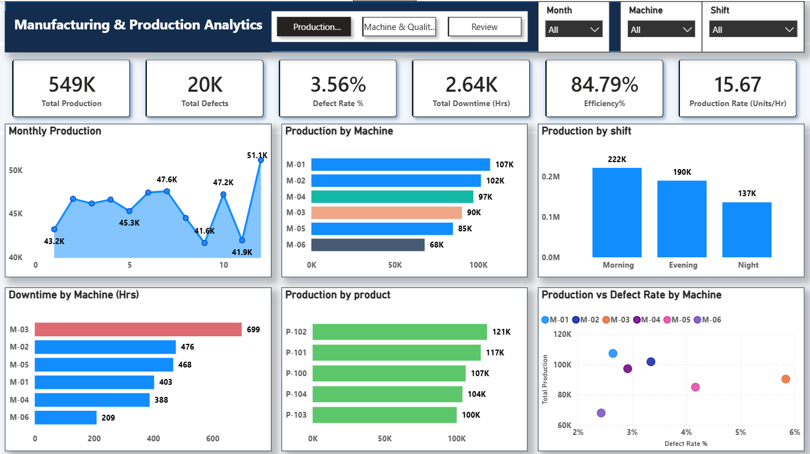
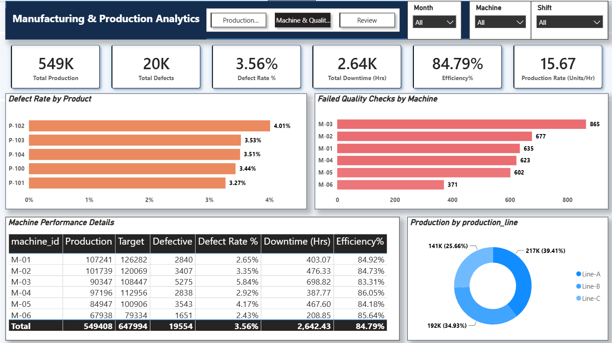
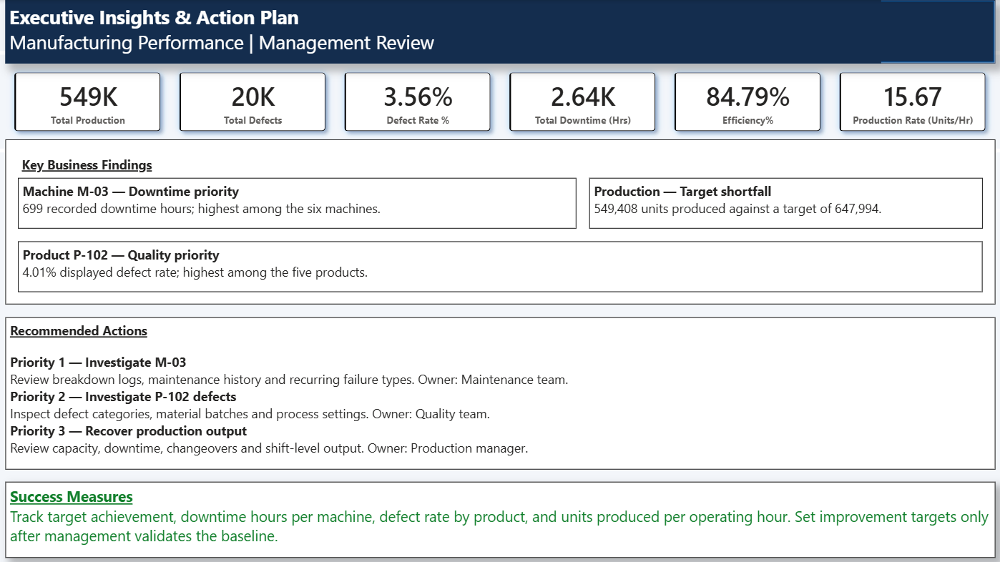

# Manufacturing & Production Analytics | Power BI

An end-to-end manufacturing analytics project built to understand production performance, machine downtime, and product quality using Python and Power BI.

## Project Overview

The objective was to analyze manufacturing data, monitor key production KPIs, identify performance gaps, and translate the findings into practical recommendations for production, maintenance, and quality teams.

The dataset is synthetic and was created for this portfolio project.

## Tools Used

- **Python & Pandas:** Data inspection, preprocessing, and quality checks.
- **Power BI:** Interactive dashboards and visual analysis.
- **DAX:** KPI calculations and measures.
- **Excel:** Basic data review.
- **Git & GitHub:** Project version control and documentation.
- **Generative AI:** Productivity support during development.

*SQL was not used in this project.*

## Dashboard Pages

### 1. Production Overview

Monitors overall production output, target achievement, defects, downtime, and production trends.

**Key insights:**
- Actual production compared with planned targets.
- Production trends across months.
- Output comparison by machine, shift, and product.
- Machine downtime comparison.

### 2. Machine & Quality Analysis

Examines machine-level performance and product quality to identify areas that may need further investigation.

**Key insights:**
- Defect rate by product.
- Failed quality checks by machine.
- Machine-level production, targets, defects, and downtime.
- Production distribution across manufacturing lines.

### 3. Executive Insights & Action Plan

Summarizes the main findings and outlines recommended actions for the relevant teams.

**Key insights:**
- Machine M-03 recorded the highest downtime.
- Product P-102 had the highest displayed defect rate.
- Actual production was below the planned target.
- Recommendations include reviewing maintenance records, investigating product defects, and examining production capacity and shift-level output.

## Key KPIs

| KPI | Result |
|---|---:|
| Total Production | 549,408 units |
| Target Production | 647,994 units |
| Target Achievement | 84.79% |
| Production Gap | 98,586 units |
| Total Defects | 19,554 |
| Defect Rate | 3.56% |
| Total Downtime | 2,642.43 hours |
| Production Rate | 15.67 units/hour |

*Results are based on the synthetic dataset. Target achievement is actual production divided by target production. The dashboard currently labels this KPI as “Efficiency%”; it represents target achievement, not a complete measure of machine efficiency.*

## Business Recommendations

- **Maintenance:** Investigate M-03 breakdown logs, maintenance history, and recurring failures.
- **Quality:** Examine P-102 defect categories, material batches, and process settings.
- **Production:** Review the production shortfall, downtime, changeovers, and shift-level output.
- **Management:** Monitor KPIs regularly and establish improvement targets after validating the baseline.

These are recommended investigations, not confirmed root causes or proven savings.

## Skills Demonstrated

Python, Pandas, data-quality checks, Power BI, DAX, KPI development, dashboard design, manufacturing analytics, and business recommendations.

## Future Improvements

- Add SQL-based analysis.
- Investigate root causes using detailed maintenance and quality records.
- Explore predictive maintenance.
- Track corrective actions and KPI changes over time.

## Author

**Anil Kumar**  
Aspiring Data Analyst

[GitHub Profile](https://github.com/thandaanil987)
